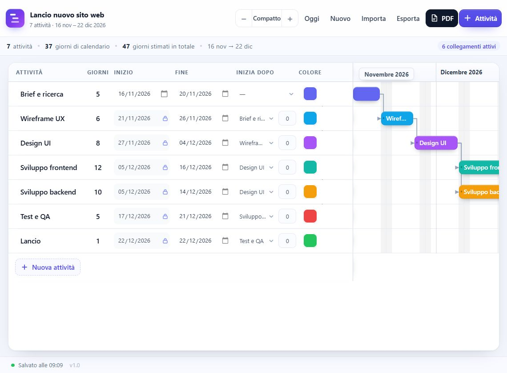

# GanttFlow

Pianificatore di attività con diagramma di Gantt, dipendenze automatiche,
esportazione PDF e file di progetto reimportabile.

App statica, **senza dipendenze e senza build**: si apre `index.html` nel browser
e funziona anche completamente offline.



## Funzionalità

- **Tabella attività** con nome, durata stimata in giorni, data di inizio e data di fine.
- **Calcolo bidirezionale**: durata + inizio → fine; inizio + fine → durata.
- **Diagramma di Gantt** a calendario con mesi, giorni, weekend evidenziati e linea di "oggi".
- **Colore personalizzato** per ogni attività, usato nella barra e nel PDF.
- **Dipendenze finish-to-start**: un'attività può iniziare il giorno dopo la fine di un'altra,
  con sfasamento opzionale (0–365 giorni). I successori si aggiornano automaticamente a catena.
- **Prevenzione dei cicli**: le combinazioni non valide non sono selezionabili.
- **Zoom** a 4 livelli, pulsante "Oggi", indicatore del mese visibile.
- **Esportazione PDF** A4 orizzontale, multipagina, con tabella e barre colorate.
- **Esportazione/Importazione progetto JSON** per riprendere il lavoro in un secondo momento.
- **Salvataggio automatico** nel browser (`localStorage`).
- Aggiunta, duplicazione, eliminazione con annullamento, progetto di esempio.
- Interfaccia responsive e interamente in italiano.

## Come si usa

Apri `index.html` con doppio clic. In alternativa, servi la cartella con un qualsiasi
server statico, ad esempio:

```powershell
# con Python installato
python -m http.server 8000
```

poi visita `http://localhost:8000/`.

### Compilare le attività

| Se inserisci… | Ottieni… |
|---|---|
| durata + inizio | la data di **fine** viene calcolata |
| inizio + fine | la **durata** viene calcolata |
| solo durata | la fine viene ricalcolata dall'inizio esistente |

La fine è inclusiva: 5 giorni a partire dal 16 novembre terminano il 20 novembre.

### Collegare le attività

Nel campo **Inizia dopo** scegli l'attività precedente. Il successore partirà il
giorno dopo la fine della precedente. Il campo **Inizio** diventa bloccato perché
calcolato; per sbloccarlo scegli `—`. Il campo numerico accanto al selettore imposta
un eventuale sfasamento in giorni.

### Scorciatoie

| Tasto | Azione |
|---|---|
| `Ctrl`/`⌘` + `S` | Esporta il progetto in JSON |
| `Ctrl`/`⌘` + `O` | Importa un progetto |
| `Ctrl`/`⌘` + rotella | Zoom del diagramma |
| `Invio` | Conferma il campo in modifica |
| `Esc` | Annulla la modifica / chiude la finestra |

## Formato del progetto

Il file esportato è JSON e può essere reimportato con il pulsante **Importa**:

```json
{
  "format": "ganttflow-project",
  "version": 1,
  "exportedAt": "2026-11-10T08:04:57.146Z",
  "project": {
    "name": "Lancio nuovo sito web",
    "createdAt": "2026-11-10T08:00:00.000Z",
    "updatedAt": "2026-11-10T08:00:00.000Z",
    "tasks": [
      {
        "id": "t9e17ounkti",
        "name": "Brief e ricerca",
        "start": "2026-11-16",
        "end": "2026-11-20",
        "duration": 5,
        "color": "#6366f1",
        "predecessorId": null,
        "lag": 0
      }
    ]
  }
}
```

- Le date usano il formato `YYYY-MM-DD` e sono giorni di calendario inclusivi.
- `predecessorId` è `null` o l'id di un'altra attività dello stesso progetto.
- `lag` è lo sfasamento in giorni dopo la fine del predecessore.
- In importazione i dati vengono validati: id non validi rigenerati, riferimenti
  inesistenti rimossi, durate e lag limitati ai valori ammessi.

## Note sul PDF

Il PDF è generato interamente in JavaScript (`js/pdf.js`), senza librerie esterne.
È un PDF vettoriale con testo selezionabile: contiene l'intestazione del progetto,
la tabella delle attività (numero, nome, giorni, inizio, fine, attività precedente)
e le barre sul calendario, con paginazione automatica quando le attività superano
lo spazio disponibile (circa 30 righe per pagina, formato A4 orizzontale).

## Struttura del progetto

```
index.html          interfaccia dell'applicazione
css/styles.css      stile e layout responsive
js/app.js           logica: modello, date, dipendenze, rendering, storage, import/export
js/pdf.js           generatore PDF autonomo
assets/favicon.svg  logo e favicon
PROJECT_CONTEXT.md  contesto, requisiti e decisioni del progetto
docs/               immagini per la documentazione
```

## Compatibilità

Funziona con le versioni recenti di Chrome, Edge, Firefox e Safari.
Richiede JavaScript abilitato; il salvataggio automatico usa `localStorage`.

## Licenza

Distribuito con licenza MIT. Vedi [LICENSE](LICENSE).
